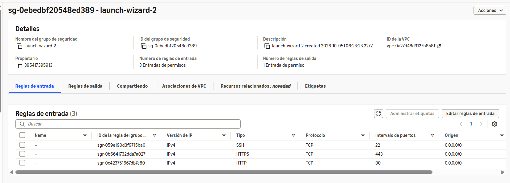
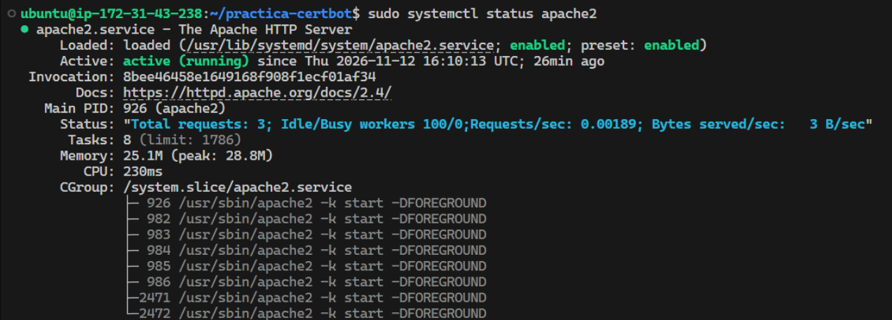
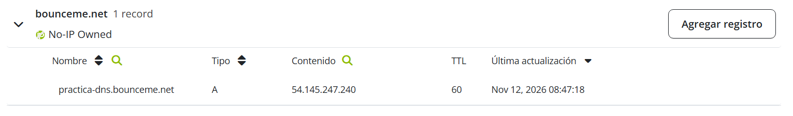
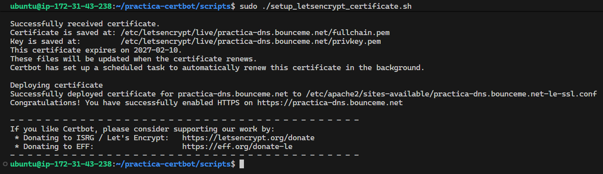
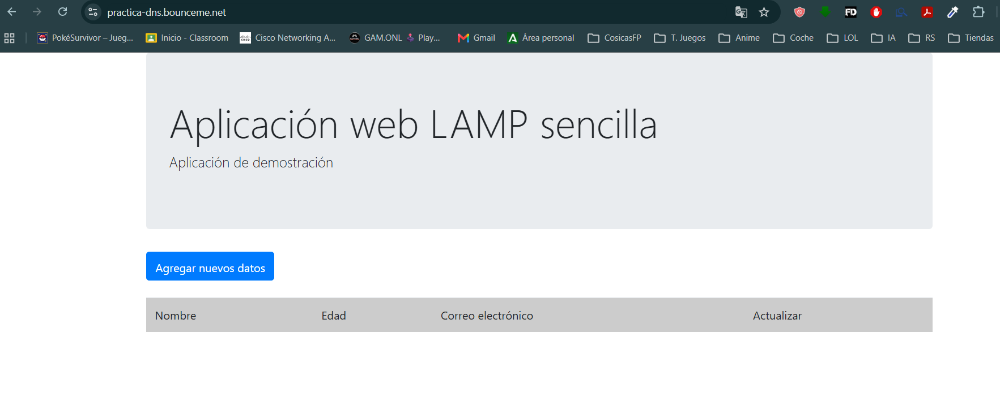
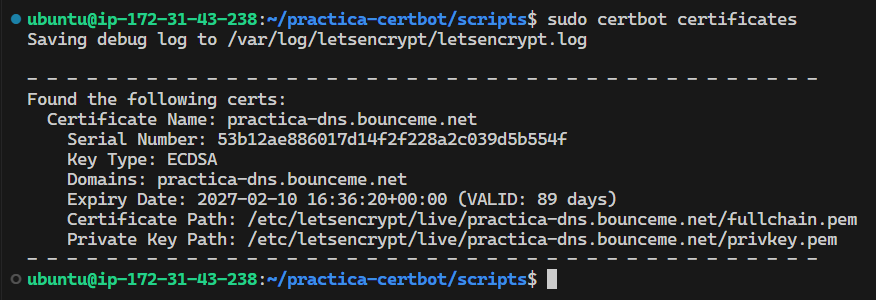
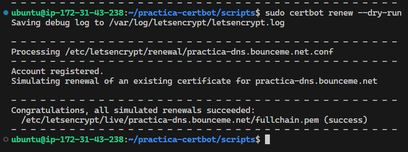

# Práctica 1.5 - HTTPS con Let's Encrypt y Certbot

**Alumno:** Alejandro Gallego Sánchez  
**Curso:** 2.º DAW  

## 1. Objetivo

El objetivo de esta práctica es configurar HTTPS en un servidor Apache utilizando un certificado gratuito de Let's Encrypt.

Para ello, he utilizado Certbot, que permite solicitar certificados SSL y configurar Apache para utilizar conexiones seguras.

También he utilizado un dominio gratuito de No-IP y he comprobado que el certificado funciona correctamente y que se puede renovar.

## 2. Configuración de la instancia EC2

Para realizar la práctica he utilizado una instancia EC2 de AWS Academy con Ubuntu Server, que ya tenía preparada de las prácticas anteriores.

He comprobado que el grupo de seguridad de la instancia tiene abiertos los puertos necesarios:

- **22:** para conectarme mediante SSH.
- **80:** para acceder mediante HTTP.
- **443:** para acceder mediante HTTPS.



## 3. Comprobación del servidor LAMP

Como ya tenía Apache, PHP y MySQL instalados de las prácticas anteriores, no ha sido necesario volver a instalarlos.

He comprobado que Apache estuviera funcionando con el comando:

```bash
sudo systemctl status apache2
```

El resultado mostraba `active (running)`.



También he comprobado que PHP estaba instalado, que MySQL se encontraba activo y que Apache respondía correctamente a las peticiones HTTP.

Para comprobar la respuesta del servidor he utilizado:

```bash
curl -I http://localhost/
```

La respuesta fue `HTTP/1.1 200 OK`.

## 4. Registro y configuración del dominio

Para solicitar el certificado de Let's Encrypt necesitaba un nombre de dominio.

He utilizado No-IP, uno de los proveedores gratuitos propuestos en el enunciado, y he configurado el siguiente subdominio:

`practica-dns.bounceme.net`

He creado un registro DNS de tipo A para que apuntara a la dirección IP pública de mi instancia EC2:

`54.145.247.240`



Después he comprobado desde Ubuntu que el dominio resolvía correctamente:

```bash
getent ahostsv4 practica-dns.bounceme.net
```

También he realizado una petición HTTP al dominio y he obtenido una respuesta `200 OK`.

## 5. Instalación y configuración de Certbot

Para esta parte he utilizado como referencia el repositorio de ejemplo del profesor:

https://github.com/josejuansanchez/practica-certbot

He trabajado con el script `setup_letsencrypt_certificate.sh`, que automatiza la configuración de Apache y la solicitud del certificado.

Inicialmente, el script intentaba instalar Certbot mediante Snap, pero apareció un error de conexión con Snap Store.

Para solucionarlo, he instalado Certbot mediante APT:

```bash
sudo apt update
sudo apt install -y certbot python3-certbot-apache
```

Después he modificado el script para que utilizara APT en lugar de Snap.

También he configurado las variables `LETS_ENCRYPT_DOMAIN` y `LETS_ENCRYPT_EMAIL` en el archivo `.env`.

Este archivo está excluido del repositorio mediante `.gitignore`.

## 6. Obtención del certificado SSL

Una vez preparado el dominio y configurado el script, he ejecutado:

```bash
sudo ./setup_letsencrypt_certificate.sh
```

Certbot ha solicitado correctamente el certificado de Let's Encrypt y ha configurado Apache para utilizar HTTPS.

También se ha configurado la redirección de HTTP a HTTPS.



## 7. Comprobación de HTTPS

Después de instalar el certificado, he accedido a la aplicación web desde el navegador utilizando la dirección:

https://practica-dns.bounceme.net

La página se ha mostrado correctamente utilizando HTTPS, sin aparecer la advertencia de seguridad que tenía con el certificado autofirmado de la práctica anterior.



## 8. Comprobación del certificado

Para consultar los datos del certificado instalado he utilizado:

```bash
sudo certbot certificates
```

El resultado mostraba el dominio, el tipo de clave y la fecha de caducidad.

El certificado utiliza una clave ECDSA y tiene como fecha de caducidad el 10 de febrero de 2027.



## 9. Renovación del certificado

Certbot ha configurado una tarea programada para renovar el certificado automáticamente cuando sea necesario.

Para comprobar que el proceso de renovación funcionaba, he ejecutado:

```bash
sudo certbot renew --dry-run
```

El comando realizó una simulación de renovación y terminó correctamente, mostrando el mensaje:

`Congratulations, all simulated renewals succeeded`



## 10. Archivos del proyecto

Los principales archivos y carpetas del proyecto son:

- `README.md`: documentación de la práctica.
- `capturas/`: capturas de pantalla del proceso.
- `scripts/install_lamp.sh`: script de instalación de LAMP.
- `scripts/setup_letsencrypt_certificate.sh`: script para instalar Certbot y configurar HTTPS.
- `scripts/.env.example`: ejemplo de las variables de configuración.
- `conf/000-default.conf`: configuración de Apache.
- `conf/virtualhost.conf.template`: plantilla del Virtual Host para el dominio.
- `php/index.php`: archivo PHP de ejemplo.
- `.gitignore`: excluye archivos privados como `.env` y las claves de certificados.

## 11. Conclusión

Con esta práctica he aprendido a configurar HTTPS en Apache utilizando un certificado gratuito de Let's Encrypt.

También he aprendido a registrar y configurar un dominio con No-IP, instalar Certbot, adaptar un script de Bash y comprobar que un certificado está instalado correctamente.

Por último, he realizado una prueba de renovación para asegurarme de que Certbot puede renovar el certificado cuando sea necesario.